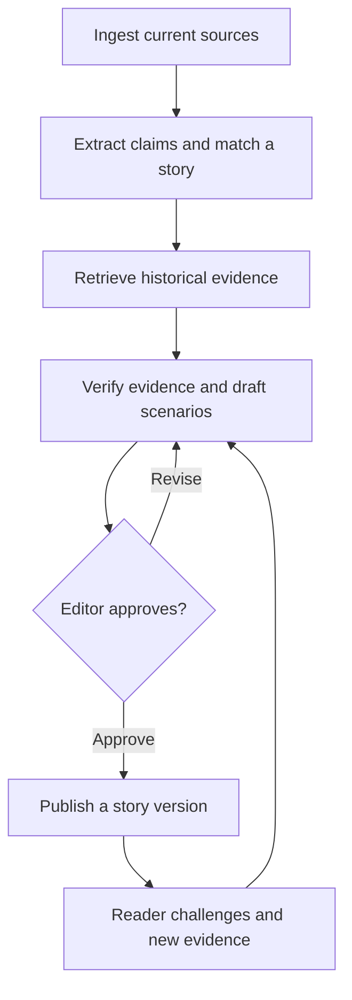

# EPSTMC

EPSTMC is an AI-assisted news project that connects today’s headlines to their sources, historical context, and what could happen next. A story is designed to evolve as new evidence arrives, with a record of what changed and why.

## Current status

The Python prototype in [draft PR #1](https://github.com/Utpal-Mishra/EPSTMC/pull/1) turns an editor-supplied JSON file into a Markdown brief. It separates reported facts, historical context, and conditional scenarios. Each entry references a listed source, and each scenario includes a condition and a signal to watch. The prototype validates source references within the brief. An editor checks whether the sources support the claims.

To run the fictional example, check out the prototype branch:

```bash
git clone --branch codex/evidence-brief-mvp https://github.com/Utpal-Mishra/EPSTMC.git
cd EPSTMC
python brief.py examples/brief.json
```

## Planned story workflow



- **Current coverage.** Collect dated updates from RSS feeds, official publications, and topic-specific APIs. Group related events into a single story and keep the original source links.
- **Historical context.** Search earlier coverage, archives, and dated datasets. Explain where a historical comparison holds, where it breaks down, and why the differences matter today.
- **Scenarios and predictions.** Map plausible next events and their potential effects across sectors or countries. Give each scenario a trigger, a timeframe, and signals that would strengthen or weaken it. Revisit scenarios when new evidence arrives.
- **Editorial review.** AI can research and draft. An editor checks claims and historical comparisons, approves publication, and records corrections in a new story version.

## Planned formats and audience feedback

| Area | Plan |
| --- | --- |
| Story formats | Publish a written brief with an image, an event or scenario diagram, a narrated audio edition, and short AI-assisted video where appropriate. Each format references the same approved story version. |
| Engagement analytics | Track story views, source clicks, audio and video completion, and responses to reader questions. |
| Reader validation | Invite readers to flag claims, answer questions, or submit sources. Cross-check submissions against reliable evidence and send substantiated changes for editorial review. |

## Proposed integrations

The providers below are candidates for the planned application.

| Layer | Proposed tools and responsibilities |
| --- | --- |
| Ingestion and historical retrieval | Python worker for RSS and official sites. Topic-specific candidates include SEC EDGAR for filings, FRED and ALFRED for economic data and historical vintages, and Congress.gov for US legislative records. |
| AI-assisted workflow | OpenAI Responses API for research, editorial drafting, and media preparation. Editors retain publication approval. |
| Web and data | Next.js for the reader experience. Supabase Postgres for stories, claims, evidence, versions, scenarios, feedback, and engagement events. Supabase Storage for media assets. |
| Media production | OpenAI image generation for illustrations, FFmpeg for assembly, and Runway and ElevenLabs as candidates for video and narration. |

The first live integration is planned around one primary source, with a traceable path from source intake to an editor-reviewed brief.

## Pre-launch roadmap

Readers will open straight to the feed without signing up. The app will refresh stories on open and resume, and readers can opt in to push alerts for major stories and material updates. Editorial publishing uses separate, protected access.

The plan starts on 7 November 2026. Week 10 ends on 15 January 2027. Dates are planning targets.

| Week | Deliverable | Completion check |
| --- | --- | --- |
| 1 | Prototype and launch scope | The sample runs, the first source is selected, and the ingestion work is ready to start. |
| 2 | Primary-source ingestion | A real update is stored with its provenance. Retrying creates no duplicate. |
| 3 | Editorial draft and review | An editor can attach historical evidence and approve a version with conditional scenarios. |
| 4 | Publishing and public read API | An approved story and its corrections reach the feed with a visible version history. |
| 5 | Account-free mobile feed | A fresh iOS or Android install opens directly to the feed and can open a story and its sources. |
| 6 | Automatic refresh and offline reading | Opening or resuming fetches updates. Offline readers can see the cached feed and its last refresh time. |
| 7 | Optional alerts and basic analytics | An approved alert opens the right story on both platforms. The feed works with alerts disabled. |
| 8 | Closed beta | Test real coverage, corrections, offline use, and notifications on physical devices. |
| 9 | Release preparation | Resolve launch blockers and prepare privacy disclosures, support details, and store submissions. |
| 10 | Launch decision | Review two weeks of editorial reliability and beta evidence. Release once critical issues are resolved and both stores approve. |

### Week 1 daily tasks

| Date | Task | Evidence to record |
| --- | --- | --- |
| 7 Nov | Review PR #1 and reproduce the example. | Successful sample render and rejection of an unknown source ID. |
| 8 Nov | Review edge cases and address any baseline issues. | Review findings, validation results, and PR status. |
| 9 Nov | Define the launch scope and editorial beat. | Scope covering account-free reading, automatic refresh, and optional alerts. |
| 10 Nov | Choose the first primary source and inspect sample entries. | Source link, sample item, and fields available for ingestion. |
| 11 Nov | Specify the evidence and story fields. | Source IDs, dates, claim references, scenario triggers, and signals. |
| 12 Nov | Define publication, correction, and alert rules. | Examples of an ordinary update, a correction, and an alert-worthy change. |
| 13 Nov | Review the Week 1 exit criteria and prepare Week 2. | Verified work, open blockers, and the next ingestion task. |

### Daily development status

<!-- epstmc-status:start -->
| Date | Verified progress | Blockers | Next task |
| --- | --- | --- | --- |
| 6 Nov 2026 | Evidence-linked brief prototype is available in draft PR #1. | Prototype review pending. | Reproduce the sample and review validation. |
| 7 Nov 2026 | Reviewed [draft PR #1](https://github.com/Utpal-Mishra/EPSTMC/pull/1). The sample rendered and all three sections rejected unknown source IDs. | No blocker for Day 1. PR remains in draft. | Review validation edge cases, starting with a source URL that accepted a nonnumeric port. |
| 8 Nov 2026 | Fixed invalid URL port validation in [draft PR #1](https://github.com/Utpal-Mishra/EPSTMC/pull/1). All 12 checks passed. | No blocker found in the validation checks. PR remains in draft. | Define the launch scope and editorial beat. |
| 9 Nov 2026 | Week 1, Day 3. No new development verified. The [URL-port fix](https://github.com/Utpal-Mishra/EPSTMC/commit/3ed93aea9f5928d216805f0b1fbaaa9a745c852a) remains in [draft PR #1](https://github.com/Utpal-Mishra/EPSTMC/pull/1). | No blocker reported for defining scope. The launch scope and editorial beat are pending. | Document the first editorial beat and launch scope for account-free reading, automatic refresh, and optional alerts. |
| 10 Nov 2026 | Week 1, Day 4. No new development verified. First-source selection and sample review are pending. The [URL-port fix](https://github.com/Utpal-Mishra/EPSTMC/commit/3ed93aea9f5928d216805f0b1fbaaa9a745c852a) remains in [draft PR #1](https://github.com/Utpal-Mishra/EPSTMC/pull/1). | The first editorial beat is still undocumented. | Record the editorial beat, choose a primary source, and document one sample entry and its ingestion fields. |
| 11 Nov 2026 | Week 1, Day 5. Evidence and story field specification is pending. No new development verified since the [URL-port fix](https://github.com/Utpal-Mishra/EPSTMC/commit/3ed93aea9f5928d216805f0b1fbaaa9a745c852a) in draft PR #1. | The editorial beat and first primary-source sample are still undocumented. | Record the beat and one sample from the chosen source, then specify source IDs, dates, claim references, scenario triggers, and signals. |
| 12 Nov 2026 | Week 1, Day 6. Publication, correction, and alert rules are pending. Development is unchanged since the [URL-port fix](https://github.com/Utpal-Mishra/EPSTMC/commit/3ed93aea9f5928d216805f0b1fbaaa9a745c852a) in [draft PR #1](https://github.com/Utpal-Mishra/EPSTMC/pull/1). | The editorial beat, primary-source sample, and evidence fields are still undocumented. | Document the first editorial beat and one primary-source sample to ground the rules. |
| 13 Nov 2026 | Selected U.S. AI infrastructure and policy as the pilot beat. [Draft PR #1](https://github.com/Utpal-Mishra/EPSTMC/pull/1) now ingests Federal Register documents into SQLite. A live [DOE notice](https://www.federalregister.gov/d/2025-05936) was stored, re-fetched without a duplicate, and rendered as a cited brief. | Intake is available in draft PR #1 and runs locally. Shared storage and the editorial queue are pending. | Add the editorial queue and connect intake to the shared evidence store. |
<!-- epstmc-status:end -->
