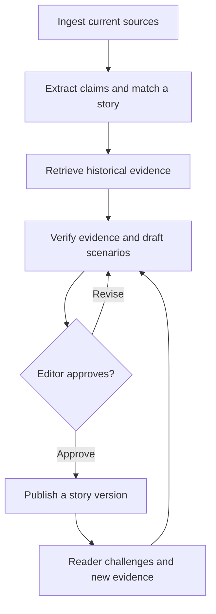

# EPSTMC

EPSTMC is an AI-assisted news project that connects today’s headlines to their sources, historical context, and what could happen next. A story is designed to evolve as new evidence arrives, with a record of what changed and why.

## Current status

The application connects primary-source intake, Week 3 editorial review and
Week 4 publication. Editors attach evidence, review conditional scenarios and
approve immutable versions. A separate publish command makes an approved version
available to the account-free reader and GET-only public API. Corrections retain
older publications and explain what changed.

Quick start with an explicitly fictional demo in a fresh database:

```bash
python demo.py --db /tmp/epstmc-reader-demo.sqlite
python app.py --db /tmp/epstmc-reader-demo.sqlite
```

Open `http://127.0.0.1:8080/` when running locally. See the
[Week 4 reader, API and publishing guide](docs/WEEK4.md),
[Week 3 editorial walkthrough](docs/WEEK3.md),
[daily development tracker](docs/DAILY_DEVELOPMENT.md) and
[project audit trail](docs/PROJECT_LOGS.md).

**Integrated:** Weeks 1–4 were merged into `main` through
[PR #1](https://github.com/Utpal-Mishra/EPSTMC/pull/1) on 23 November 2026
(merge `04f136e`). All 42 tests passed on SQLite/Python 3.9, SQLite/Python 3.12
and Postgres 16 in [the release CI run](https://github.com/Utpal-Mishra/EPSTMC/actions/runs/45278577458).
Hosted production database setup, public deployment and browser visual QA remain
pending. See the [launch and editorial policy](docs/EDITORIAL_POLICY.md).
No real story was automatically approved or published.

The original fictional brief still runs with:

```bash
python brief.py examples/brief.json
```

## Planned story workflow



- **Current coverage.** Collect dated updates from RSS feeds, official publications, and topic-specific APIs. Group related events into a single story and keep the original source links.
- **Historical context.** Search earlier coverage, archives, and dated datasets. Explain where a historical comparison holds, where it breaks down, and why the differences matter today.
- **Scenarios and predictions.** Map plausible next events and their potential effects across sectors or countries. Give each scenario a trigger, a timeframe, and signals that would strengthen or weaken it. Revisit scenarios when new evidence arrives.
- **Editorial review.** AI can research and draft. An editor checks claims and historical comparisons, approves publication, and records corrections in a new story version.

## Planned formats and audience feedback

| Area | Plan |
| --- | --- |
| Story formats | Publish a written brief with an image, an event or scenario diagram, a narrated audio edition, and short AI-assisted video where appropriate. Each format references the same approved story version. |
| Engagement analytics | Track story views, source clicks, audio and video completion, and responses to reader questions. |
| Reader validation | Invite readers to flag claims, answer questions, or submit sources. Cross-check submissions against reliable evidence and send substantiated changes for editorial review. |

## Proposed integrations

The providers below are candidates for the planned application.

| Layer | Proposed tools and responsibilities |
| --- | --- |
| Ingestion and historical retrieval | Python worker for RSS and official sites. Topic-specific candidates include SEC EDGAR for filings, FRED and ALFRED for economic data and historical vintages, and Congress.gov for US legislative records. |
| AI-assisted workflow | OpenAI Responses API for research, editorial drafting, and media preparation. Editors retain publication approval. |
| Web and data | Next.js for the reader experience. Supabase Postgres for stories, claims, evidence, versions, scenarios, feedback, and engagement events. Supabase Storage for media assets. |
| Media production | OpenAI image generation for illustrations, FFmpeg for assembly, and Runway and ElevenLabs as candidates for video and narration. |

## First source intake

The pilot beat is **U.S. AI infrastructure and policy**, starting with federal notices, rules, and executive actions relevant to data centres and their supporting infrastructure. The first source is the [Federal Register published-documents API](https://www.federalregister.gov/reader-aids/developer-resources/rest-api). Search results are candidates for editorial screening. A search match alone does not establish that an item belongs in the beat.

Run from the prototype branch with Python 3.9+ and internet access. The API requires no key. SQLite mode uses the Python standard library.

```bash
python ingest.py --db /tmp/epstmc-evidence.sqlite --document 2025-05936
python ingest.py --db /tmp/epstmc-evidence.sqlite --limit 10
python ingest.py --db /tmp/epstmc-evidence.sqlite --list
```

The first command fetches the Department of Energy’s [AI infrastructure notice](https://www.federalregister.gov/d/2025-05936), published on 7 April 2025. It is a reproducible historical sample. The second command fetches the first page of results for the pilot search, newest first. Use `--query` to supply a different search term. The third command exports the local records for review.

| Stored evidence | Use |
| --- | --- |
| `id`, `document_number` | The Federal Register document number gives each item a stable ID, such as `fr-2025-05936`. Repeated intake updates the same row. |
| `title`, `url`, `document_type` | Identify the original document and the kind of action reported. |
| `publication_date`, `official_pdf_url` | Record the publication date and the official electronic edition link when supplied. |
| `first_retrieved_at`, `last_retrieved_at` | Record the first and most recent successful intake in UTC. |

The editorial workflow resolves source IDs against these stored evidence records and snapshots their metadata into each version. An editor supplies claims, checks the source, and explicitly approves a reviewed version. See [the walkthrough](docs/WEEK3.md).

### Shared Postgres storage

The importer can also use a Postgres database shared by the ingestion worker and
editorial tools. Set `EPSTMC_DATABASE_URL` through your shell or deployment secret
store. Use the database provider’s TLS settings for a hosted connection.

Apply the [schema migration](migrations/001_federal_register_evidence.sql) with
the schema owner’s connection. If the worker uses a separate database role, grant
it `USAGE` on the `epstmc` schema and `SELECT, INSERT, UPDATE` on
`epstmc.federal_register_evidence`. For hosted Postgres keep this schema out of
any public API exposure settings.

```bash
python -m pip install -r requirements-postgres.txt
# Run with the schema owner's connection for initial setup.
psql "$EPSTMC_DATABASE_URL" -v ON_ERROR_STOP=1 -f migrations/001_federal_register_evidence.sql
# Run with the worker's connection for intake and export.
python ingest.py --postgres --document 2025-05936
python ingest.py --postgres --list
```

The same document ID updates one record, preserves its first successful intake
timestamp, and advances its last successful intake timestamp. The JSON export
uses the same fields and UTC timestamp format as SQLite. Existing SQLite records
remain in their database. Re-fetch a document using `--postgres` to record it
in shared storage. Intake runs on demand. Apply migration 002 to use the integrated
[editorial review queue](docs/WEEK3.md).

## History-to-present website

The [history-to-present integration](docs/HISTORY_TO_PRESENT.md) implements
one real source-backed case, dated evidence, year/month timeline navigation,
source candidates and freshness, protected browser review and durable D1 data.
The story remains a private research preview until owner approval. The
original daily plan is retained as history; subsequent tasks maintain the release.

## Pre-launch roadmap

Readers will open straight to the feed without signing up. The app will refresh stories on open and resume, and readers can opt in to push alerts for major stories and material updates. Editorial publishing uses separate, protected access.

The plan starts on 7 November 2026. Week 10 ends on 15 January 2027. Dates are planning targets.

| Week | Deliverable | Completion check |
| --- | --- | --- |
| 1 | Prototype and launch scope | The sample runs, the first source is selected, and the ingestion work is ready to start. |
| 2 | Primary-source ingestion | A real update is stored with its provenance. Retrying creates no duplicate. |
| 3 | Editorial draft and review | An editor can attach historical evidence and approve a version with conditional scenarios. |
| 4 | Publishing and public read API | An approved story and its corrections reach the feed with a visible version history. |
| 5 | Account-free mobile feed | A fresh iOS or Android install opens directly to the feed and can open a story and its sources. |
| 6 | Automatic refresh and offline reading | Opening or resuming fetches updates. Offline readers can see the cached feed and its last refresh time. |
| 7 | Optional alerts and basic analytics | An approved alert opens the right story on both platforms. The feed works with alerts disabled. |
| 8 | Closed beta | Test real coverage, corrections, offline use, and notifications on physical devices. |
| 9 | Release preparation | Resolve launch blockers and prepare privacy disclosures, support details, and store submissions. |
| 10 | Launch decision | Review two weeks of editorial reliability and beta evidence. Release once critical issues are resolved and both stores approve. |

### Week 1 daily tasks

| Date | Task | Evidence to record |
| --- | --- | --- |
| 7 Nov | Review PR #1 and reproduce the example. | Successful sample render and rejection of an unknown source ID. |
| 8 Nov | Review edge cases and address any baseline issues. | Review findings, validation results, and PR status. |
| 9 Nov | Define the launch scope and editorial beat. | Scope covering account-free reading, automatic refresh, and optional alerts. |
| 10 Nov | Choose the first primary source and inspect sample entries. | Source link, sample item, and fields available for ingestion. |
| 11 Nov | Specify the evidence and story fields. | Source IDs, dates, claim references, scenario triggers, and signals. |
| 12 Nov | Define publication, correction, and alert rules. | Examples of an ordinary update, a correction, and an alert-worthy change. |
| 13 Nov | Review the Week 1 exit criteria and prepare Week 2. | Verified work, open blockers, and the next ingestion task. |

### Daily development status

<!-- epstmc-status:start -->
| Date | Verified progress | Blockers | Next task |
| --- | --- | --- | --- |
| 6 Nov 2026 | Evidence-linked brief prototype is available in draft PR #1. | Prototype review pending. | Reproduce the sample and review validation. |
| 7 Nov 2026 | Reviewed [draft PR #1](https://github.com/Utpal-Mishra/EPSTMC/pull/1). The sample rendered and all three sections rejected unknown source IDs. | No blocker for Day 1. PR remains in draft. | Review validation edge cases, starting with a source URL that accepted a nonnumeric port. |
| 8 Nov 2026 | Fixed invalid URL port validation in [draft PR #1](https://github.com/Utpal-Mishra/EPSTMC/pull/1). All 12 checks passed. | No blocker found in the validation checks. PR remains in draft. | Define the launch scope and editorial beat. |
| 9 Nov 2026 | Week 1, Day 3. No new development verified. The [URL-port fix](https://github.com/Utpal-Mishra/EPSTMC/commit/3ed93aea9f5928d216805f0b1fbaaa9a745c852a) remains in [draft PR #1](https://github.com/Utpal-Mishra/EPSTMC/pull/1). | No blocker reported for defining scope. The launch scope and editorial beat are pending. | Document the first editorial beat and launch scope for account-free reading, automatic refresh, and optional alerts. |
| 10 Nov 2026 | Week 1, Day 4. No new development verified. First-source selection and sample review are pending. The [URL-port fix](https://github.com/Utpal-Mishra/EPSTMC/commit/3ed93aea9f5928d216805f0b1fbaaa9a745c852a) remains in [draft PR #1](https://github.com/Utpal-Mishra/EPSTMC/pull/1). | The first editorial beat is still undocumented. | Record the editorial beat, choose a primary source, and document one sample entry and its ingestion fields. |
| 11 Nov 2026 | Week 1, Day 5. Evidence and story field specification is pending. No new development verified since the [URL-port fix](https://github.com/Utpal-Mishra/EPSTMC/commit/3ed93aea9f5928d216805f0b1fbaaa9a745c852a) in draft PR #1. | The editorial beat and first primary-source sample are still undocumented. | Record the beat and one sample from the chosen source, then specify source IDs, dates, claim references, scenario triggers, and signals. |
| 12 Nov 2026 | Week 1, Day 6. Publication, correction, and alert rules are pending. Development is unchanged since the [URL-port fix](https://github.com/Utpal-Mishra/EPSTMC/commit/3ed93aea9f5928d216805f0b1fbaaa9a745c852a) in [draft PR #1](https://github.com/Utpal-Mishra/EPSTMC/pull/1). | The editorial beat, primary-source sample, and evidence fields are still undocumented. | Document the first editorial beat and one primary-source sample to ground the rules. |
| 13 Nov 2026 | Selected U.S. AI infrastructure and policy as the pilot beat. [Draft PR #1](https://github.com/Utpal-Mishra/EPSTMC/pull/1) now ingests Federal Register documents into SQLite. A live [DOE notice](https://www.federalregister.gov/d/2025-05936) was stored, re-fetched without a duplicate, and rendered as a cited brief. | Intake is available in draft PR #1 and runs locally. Shared storage and the editorial queue are pending. | Add the editorial queue and connect intake to the shared evidence store. |
| 14 Nov 2026 | Week 2, Day 1. Primary-source ingestion is unchanged since 13 Nov. The [Federal Register importer](https://github.com/Utpal-Mishra/EPSTMC/commit/af2a27ca346b6d3c7219b534dff39388c6a4b852) stored a DOE notice with provenance and re-fetched it without a duplicate in local SQLite. | Importer runs manually in [draft PR #1](https://github.com/Utpal-Mishra/EPSTMC/pull/1). Shared storage and editorial queue are pending. | Connect intake to shared Postgres and verify that re-fetching the same notice creates one evidence record. |
| 15 Nov 2026 | Week 2, Day 2. Ingestion is unchanged since 13 Nov. The [Federal Register importer](https://github.com/Utpal-Mishra/EPSTMC/commit/af2a27ca346b6d3c7219b534dff39388c6a4b852) stored one DOE notice with provenance after two fetches in local SQLite. | [Draft PR #1](https://github.com/Utpal-Mishra/EPSTMC/pull/1) runs manually. Shared storage and the editorial review queue are pending. | Connect intake to shared Postgres and verify that two fetches of the same notice leave one record with provenance intact. |
| 16 Nov 2026 | Week 2, Day 3. [Postgres ingestion](https://github.com/Utpal-Mishra/EPSTMC/commit/3c3b07ef36a29979b83a7c58dcf9ec63f7ec6ab1) in [draft PR #1](https://github.com/Utpal-Mishra/EPSTMC/pull/1) passed local testing. Repeated and concurrent imports of a Federal Register DOE notice left one record with its source link, publication date, and first retrieval timestamp intact. | Hosted Postgres setup and validation are pending. The editorial review queue is pending. | Apply the migration on hosted Postgres, import notice 2025-05936 twice, and verify one record with its provenance intact. |
| 17 Nov 2026 | Week 2, Day 4. No new development verified since 16 Nov. [Draft PR #1](https://github.com/Utpal-Mishra/EPSTMC/pull/1) last verified one evidence record with provenance after repeated and concurrent imports on [local Postgres](https://github.com/Utpal-Mishra/EPSTMC/commit/3c3b07ef36a29979b83a7c58dcf9ec63f7ec6ab1). | Hosted Postgres setup and validation and the editorial review queue are pending. | Apply the hosted migration, import DOE notice 2025-05936 twice, and confirm one record with provenance intact. |
| 18 Nov 2026 | Week 2, Day 5. Development is unchanged since 16 Nov. [Postgres ingestion](https://github.com/Utpal-Mishra/EPSTMC/commit/3c3b07ef36a29979b83a7c58dcf9ec63f7ec6ab1) remains in [draft PR #1](https://github.com/Utpal-Mishra/EPSTMC/pull/1). The recorded local test kept one evidence record with provenance after repeated and concurrent imports. | Hosted Postgres setup and validation remain pending. The editorial review queue is pending. | Apply the migration to hosted Postgres, import DOE notice 2025-05936 twice, and verify one record with provenance intact. |
| 19 Nov 2026 | Week 2, Day 6. Development is unchanged since 16 Nov. [Postgres ingestion](https://github.com/Utpal-Mishra/EPSTMC/commit/3c3b07ef36a29979b83a7c58dcf9ec63f7ec6ab1) remains in [draft PR #1](https://github.com/Utpal-Mishra/EPSTMC/pull/1). The recorded local test kept one record with provenance after repeated and concurrent imports. | Hosted Postgres setup and validation remain pending. The editorial review queue is pending. | Apply the migration to hosted Postgres, import DOE notice 2025-05936 twice, and verify one record with provenance intact. |
| 20 Nov 2026 | Week 2, Day 7. Development is unchanged since 16 Nov. [Postgres ingestion](https://github.com/Utpal-Mishra/EPSTMC/commit/3c3b07ef36a29979b83a7c58dcf9ec63f7ec6ab1) remains in [draft PR #1](https://github.com/Utpal-Mishra/EPSTMC/pull/1). The recorded local test stored a real notice with provenance and kept one record after repeated and concurrent imports. | Hosted Postgres setup and validation remain pending. The editorial review queue is pending. | Apply the migration to hosted Postgres, import DOE notice 2025-05936 twice, and verify one record with provenance intact. |
| 21 Nov 2026 | Week 3, Day 1. Editorial draft and review is the planned milestone and remains pending. Development is unchanged since 16 Nov. [Postgres ingestion](https://github.com/Utpal-Mishra/EPSTMC/commit/3c3b07ef36a29979b83a7c58dcf9ec63f7ec6ab1) in [draft PR #1](https://github.com/Utpal-Mishra/EPSTMC/pull/1) has recorded local provenance and duplicate-prevention checks. | Hosted Postgres setup and validation and the editorial review queue remain pending. | Apply the hosted migration and verify two imports of DOE notice 2025-05936 leave one record, then connect an editorial draft to stored evidence. |
| 22 Nov 2026 | Week 3, Day 2. Editorial draft and review remains pending. Development is unchanged since 16 Nov. [Postgres ingestion](https://github.com/Utpal-Mishra/EPSTMC/commit/3c3b07ef36a29979b83a7c58dcf9ec63f7ec6ab1) in [draft PR #1](https://github.com/Utpal-Mishra/EPSTMC/pull/1) has recorded local provenance and duplicate-prevention checks. | Hosted Postgres setup and validation remain pending, along with the editorial review queue. | Apply the hosted migration and verify two imports of DOE notice 2025-05936 leave one record, then connect an editorial draft to stored evidence. |
| 23 Nov 2026 | Weeks 1–4 and all seven history-to-present units merged (PRs #1–#3). Real-source private timeline, browser review, durable D1 and freshness are deployed. All 45 Python and 18 Worker/D1 tests pass; live intake stored 20 pending candidates. | Real story remains a research preview awaiting owner review; broader coverage and physical-device QA remain open. | Inspect the timeline and review queued sources; daily runs maintain reliability and bounded fixes. |
| 24 Nov 2026 | PR #3 and current main release CI verified green. Private Site v5 remains owner-only; D1 draft v1 has five events. Live Federal Register intake succeeded at 09:48:40 UTC with 20 unreviewed matches; separate status read confirmed persistence. 45 local Python tests passed. Application code unchanged. | Latest covered event remains 6 Nov; original-source research/retrieval remains 23 Nov. Owner review, wider coverage and physical-device QA remain open. | Review candidates and coverage gaps; make a bounded fix only for an observed issue. See [daily evidence](docs/DAILY_DEVELOPMENT.md#24-november-2026--freshness-verification). |
<!-- epstmc-status:end -->
