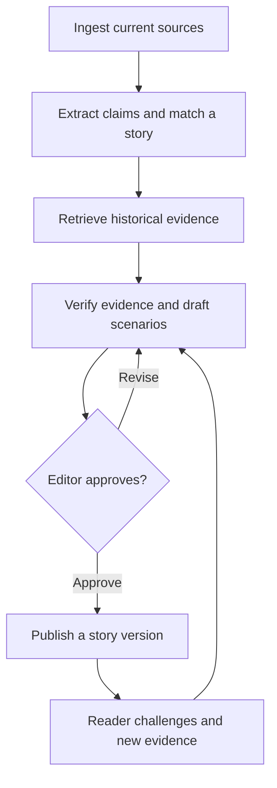

# EPSTMC

EPSTMC is an AI-assisted news project that connects today’s headlines to their sources, historical context, and what could happen next. A story is designed to evolve as new evidence arrives, with a record of what changed and why.

## Current status

The Python prototype in [draft PR #1](https://github.com/Utpal-Mishra/EPSTMC/pull/1) turns an editor-supplied JSON file into a Markdown brief. It separates reported facts, historical context, and conditional scenarios. Each entry references a listed source, and each scenario includes a condition and a signal to watch. The prototype validates source references within the brief. An editor checks whether the sources support the claims.

To run the fictional example, check out the prototype branch:

```bash
git clone --branch codex/evidence-brief-mvp https://github.com/Utpal-Mishra/EPSTMC.git
cd EPSTMC
python brief.py examples/brief.json
```

## Planned story workflow



- **Current coverage.** Collect dated updates from RSS feeds, official publications, and topic-specific APIs. Group related events into a single story and keep the original source links.
- **Historical context.** Search earlier coverage, archives, and dated datasets. Explain where a historical comparison holds, where it breaks down, and why the differences matter today.
- **Scenarios and predictions.** Map plausible next events and their potential effects across sectors or countries. Give each scenario a trigger, a timeframe, and signals that would strengthen or weaken it. Revisit scenarios when new evidence arrives.
- **Editorial review.** AI can research and draft. An editor checks claims and historical comparisons, approves publication, and records corrections in a new story version.

## Planned formats and audience feedback

| Area | Plan |
| --- | --- |
| Story formats | Publish a written brief with an image, an event or scenario diagram, a narrated audio edition, and short AI-assisted video where appropriate. Each format references the same approved story version. |
| Engagement analytics | Track story views, source clicks, audio and video completion, and responses to reader questions. |
| Reader validation | Invite readers to flag claims, answer questions, or submit sources. Cross-check submissions against reliable evidence and send substantiated changes for editorial review. |

## Proposed integrations

The providers below are candidates for the planned application.

| Layer | Proposed tools and responsibilities |
| --- | --- |
| Ingestion and historical retrieval | Python worker for RSS and official sites. Topic-specific candidates include SEC EDGAR for filings, FRED and ALFRED for economic data and historical vintages, and Congress.gov for US legislative records. |
| AI-assisted workflow | OpenAI Responses API for research, editorial drafting, and media preparation. Editors retain publication approval. |
| Web and data | Next.js for the reader experience. Supabase Postgres for stories, claims, evidence, versions, scenarios, feedback, and engagement events. Supabase Storage for media assets. |
| Media production | OpenAI image generation for illustrations, FFmpeg for assembly, and Runway and ElevenLabs as candidates for video and narration. |

The first live integration is planned around one primary source, with a traceable path from source intake to an editor-reviewed brief.
